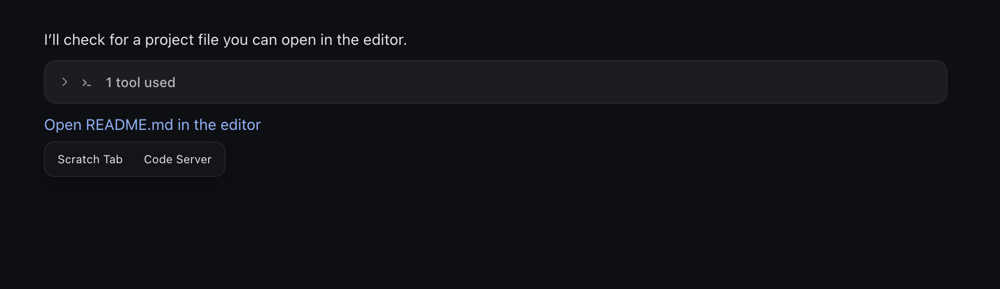

# Scratch Tab

A lightweight text editor for [Remote](https://github.com/futrx-com/remote.futrx). Open small workspace files in movable windows, make a quick edit, and get back to your conversation.

[Download Scratch Tab](https://github.com/Ahmedwaleed22/scratch-tab-remote-application/releases/latest) · [License](LICENSE)

## Install

Download the installable ZIP, upload it through **Settings → Applications**, then install and start Scratch Tab in your project. The first installation of a version with the updater still requires uploading its ZIP and refreshing Remote. After that, administrators can use **Applications → Scratch Tab card → Updates**. It checks GitHub when opened and every six hours while open. Click **Update** to install a newer stable release; updating replaces Scratch Tab across all projects on the server. Save work in other tabs first. Unsaved Scratch Tab drafts in this tab block installation and refresh. Failed project upgrades are reported without refreshing. Manual ZIP uploads remain available.

## Open a file

Click a workspace file link in an agent message, or select a text file in the file manager. Choose **Scratch Tab** or **Code Server** from the small menu beside the file. File-manager search results work the same way.

## Edit and save

Edit the text, then click **Save** or press **Ctrl/Cmd+S**. A dot beside the filename marks unsaved changes. **Open in Code Server** opens the same file in the full editor.

On phones, the editor fits the visible screen and keeps its controls above the keyboard. Tap the text to start editing. On desktop, drag the title bar to move the window and resize it from the corner. Open several files as tabs in the active window. Select a tab to switch files, or click **Separate window** to split the active tab into its own movable window. Selecting an already open file brings its tab and window forward. Each file keeps its own edits and Save action. Click the red dot or press Escape to close the active file; other tabs stay open. If there are unsaved changes, Scratch Tab asks before discarding them.

For keyboard navigation, use the arrow keys in the editor-choice menu. Use Left/Right or Home/End on the file tabs to switch between them. Focus a window’s title bar and use the arrow keys to move it.

## Files and drafts

- Supports existing UTF-8 text files up to **128 KiB** inside `/workspace`. Word documents and files rejected by the text reader show **File not supported** with a **Download file** action.
- Folders, downloads, images, audio, video, PDFs and archives keep Remote’s usual behavior.
- Save is explicit; there is no autosave or automatic backup. Creating, renaming and deleting files stays in Remote or Code Server.
- If a file changed on disk since you opened it, saving reports a conflict. Copy your edits before reopening the file.
- Windows, tabs, edits and their positions stay open when switching chats within the same project. Leaving the project closes the windows and keeps unsaved drafts in browser memory. Refreshing or closing the browser loses those drafts, so save your work before leaving.
- CRLF line endings are preserved. Mixed line endings normalize when saved. Symlinks and binary files are not editable; hard links and extended file attributes are not preserved on save.

Stopping or uninstalling Scratch Tab keeps your workspace files.

## License

Copyright © 2026 Futrx. Licensed under **AGPL-3.0-or-later**. See [LICENSE](LICENSE) for the complete text. Provided without warranty.
