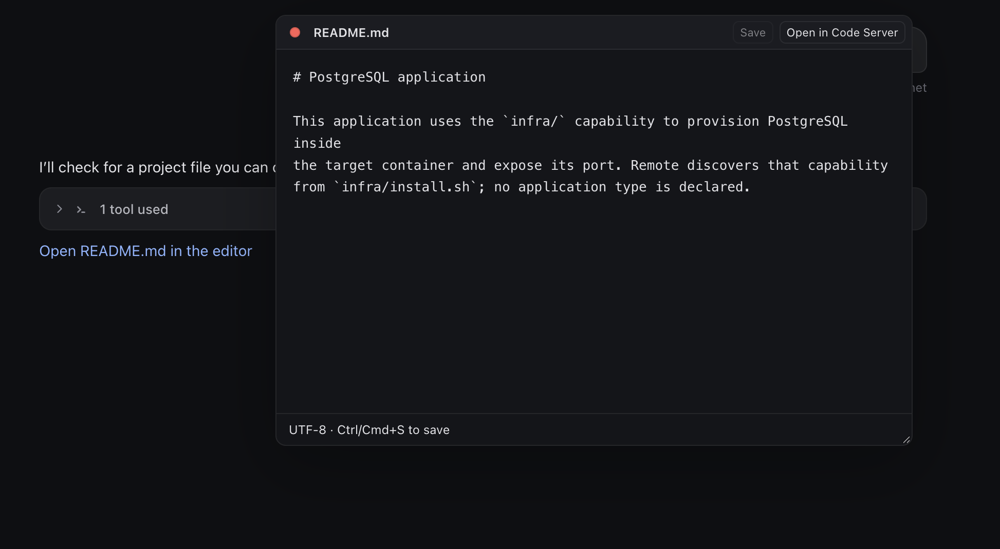

# Scratch Tab

A lightweight text editor app for [Remote](https://github.com/futrx-com/remote.futrx), developed independently by Pixlotech. Open small workspace files in movable windows, make a quick edit, and get back to your conversation.

[Download Scratch Tab](https://github.com/Ahmedwaleed22/scratch-tab-remote-application/releases/latest) · [License](LICENSE)

## Install

Download the installable ZIP, upload it through **Settings → Applications**, then install and start Scratch Tab in your project. The first installation of a version with the updater still requires uploading its ZIP and refreshing Remote. After that, administrators can use **Applications → Scratch Tab card → Updates**. An update icon also appears in the chat toolbar when a newer version is available; click it to open the same updater. Background checks run when opening a chat and hourly while it remains open, with recent results reused between chats. The icon is shown only to administrators. The updater also checks GitHub when opened and every six hours while open. GitHub release results may be cached for up to one hour. Click **Update** to install a newer stable release; updating replaces Scratch Tab across all projects on the server. Save work in other tabs first. Unsaved Scratch Tab drafts in this tab block installation and refresh. Failed project upgrades are reported without refreshing. Manual ZIP uploads remain available.

## Open a file

Code Server is not required. Scratch Tab registers its own file opener on Remote versions that support application file openers.

Click a workspace file link in an agent message, or select a text file in the file manager. Supported files open directly in Scratch Tab. File-manager search results work the same way.

Each window has a **Files** sidebar on the left that browses the workspace like Remote's file manager. Folders load as you expand them, and the folders containing the current file open automatically with that file highlighted. Select a file to open it as a tab in the same window; images, media and archives download instead. The sidebar starts closed: use the panel button at the left of the tab bar to show or hide it, and Scratch Tab remembers that choice in this browser. Tabs show a file-type icon beside the name; the close button appears on the active tab and on hover. On phones the sidebar opens as a drawer over the editor and closes after you pick a file. The tab strip and file tree scroll without visible scrollbars. Selecting a tab expands its parent folders and scrolls the selected file into view. Use the refresh button to pick up files created or deleted elsewhere; it shows progress and a success or failure message.

## Edit and save

Programming files get syntax highlighting based on their extension: JavaScript/JSX, TypeScript/TSX, Python, Go, JSON, shell, HTML/XML, CSS, Markdown, YAML, SQL, Rust, Java, C/C++, and PHP. Unknown extensions stay plain text. Highlighting updates as you type and does not reformat or change the file. Very large drafts and lines over 8,192 characters display without colors to keep editing responsive.

Files ending in `.md` or `.markdown` open in Preview initially. Use **Source** to edit or **Preview** to read; Scratch Tab remembers your last choice in this browser for newly opened Markdown files, including after a refresh. If browser storage is blocked, the choice lasts for the current page session. Preview shows your current unsaved edits, including headings, emphasis, lists, tables, images, links, code blocks, and Mermaid diagrams. Switching views does not save or rewrite the file. Embedded HTML supports formatting such as centered headings, linked images and expandable details. Scripts, event handlers, embedded pages and arbitrary styles are removed from the preview. HTML and Markdown links and images use the same workspace path rules; use a full `https://` URL for an external image. HTML inside code spans and fenced blocks stays visible as source. Wide diagrams scroll horizontally on phones. Invalid diagrams keep their source visible with an error message.

Press **Enter** to continue the current line’s indentation. **Tab** inserts indentation to the next tab stop; **Shift+Tab** removes one level. With multiple lines selected, Tab and Shift+Tab indent or outdent the selected lines together. These edits support Undo/Redo.

The bottom-left status control shows **Spaces: N** or **Tab Size: N**. Click it to choose spaces or tabs and a width from 1–8, change tab display width, detect indentation from the file, convert existing indentation, or trim trailing whitespace. New files detect their indentation from content, using your remembered choice when no indentation is present. Changing the mode or display size does not rewrite the file; conversion and trimming change the draft and require Save.

Use **Find** or **Ctrl/Cmd+F** to search the current file, including unsaved edits. The floating bar follows Remote’s find-bar design, with highlighted matches, a result count, previous/next buttons, and a close button. Search is literal and case insensitive. Enter moves to the next result, Shift+Enter to the previous result, and Escape closes search before closing the editor. Searching Markdown switches to Source. Each file keeps its own search state.

Edit the text, then click **Save** or press **Ctrl/Cmd+S**. A dot beside the filename marks unsaved changes. **Open with default editor** appears only for an existing editor link supplied by Remote. Scratch-generated links and file-manager entries hide the button because the current extension API cannot determine whether another editor is available. Scratch does not require changes to Remote core.



On phones, the editor fits the visible screen and keeps its controls above the keyboard. Tap the text to start editing. On desktop, drag the title bar to move the window and resize it from the corner. Open several files as tabs in the active window. Select a tab to switch files. On desktop, click **Separate window** to split the active tab into its own movable window; this action is hidden on phones. Selecting an already open file brings its tab and window forward. Each file keeps its own edits and Save action. Click the X beside a tab name to close only that file. Click the red dot or press Escape to close the whole window and all its tabs. If there are unsaved changes, Scratch Tab asks before discarding them.

For keyboard navigation, use Left/Right or Home/End on the file tabs to switch between them. Focus a window’s title bar and use the arrow keys to move it.

## Files and drafts

- Supports existing UTF-8 text files up to **128 KiB** inside `/workspace`. Word documents and files rejected by the text reader show **File not supported** with a **Download file** action.
- Folders, downloads, images, audio, video, PDFs and archives keep Remote’s usual behavior.
- Save is explicit; there is no autosave or automatic backup. Apart from recreating a deleted file, creating, renaming and deleting files stays in Remote or Code Server.
- If a file changed on disk since you opened it, saving reports a conflict. Copy your edits before reopening the file.
- If a file was deleted or moved, opening it shows **File not found** with **Try again** and **Close tab**. If it is deleted while open, your text stays in the editor and **Save** becomes **Recreate**, which writes the text back to the same path. Recreating needs the folder to exist and never overwrites a file that has appeared there since. An unsaved draft of a deleted file reopens ready to recreate.
- Windows, tabs, edits and their positions stay open when switching chats within the same project. Leaving the project closes the windows and keeps unsaved drafts in browser memory. Refreshing or closing the browser loses those drafts, so save your work before leaving.
- CRLF line endings are preserved. Mixed line endings normalize when saved. Symlinks and binary files are not editable; hard links and extended file attributes are not preserved on save.

Stopping or uninstalling Scratch Tab keeps your workspace files.

## Development

Requires Node.js 22.18 or later. The frontend uses Preact and TypeScript, with Vitest for tests and Playwright for browser scenarios:

```text
dev/frontend/src/
├── pages/          # Editor.tsx, Updates.tsx
├── components/    # Shared Preact UI
├── App.tsx        # Remote integration and application composition
└── index.tsx      # Entry point
```

Document services, API calls, adapters, presenters and configuration also live in `dev/frontend/src/` as `.ts` files. Styles stay in `dev/frontend/ui/style/`.

```sh
npm ci
npx playwright install chromium
npm test
npm run format:check
npm run test:infra
```

`npm run build` bundles the frontend into `dist/main.js`. Only JavaScript is emitted in `dist`; TypeScript checking runs separately with `npm run typecheck`. The ZIP packager places that bundle at the existing `ui/scripts/main.js` runtime entry, alongside CSS, backend files and third-party license notices. Run the build before packaging. See [maintenance notes](docs/maintenance.md) for backend and release checks.

## License

Copyright © 2026 Pixlotech. Licensed under **AGPL-3.0-or-later**. See [LICENSE](LICENSE) for the complete text. Provided without warranty.
